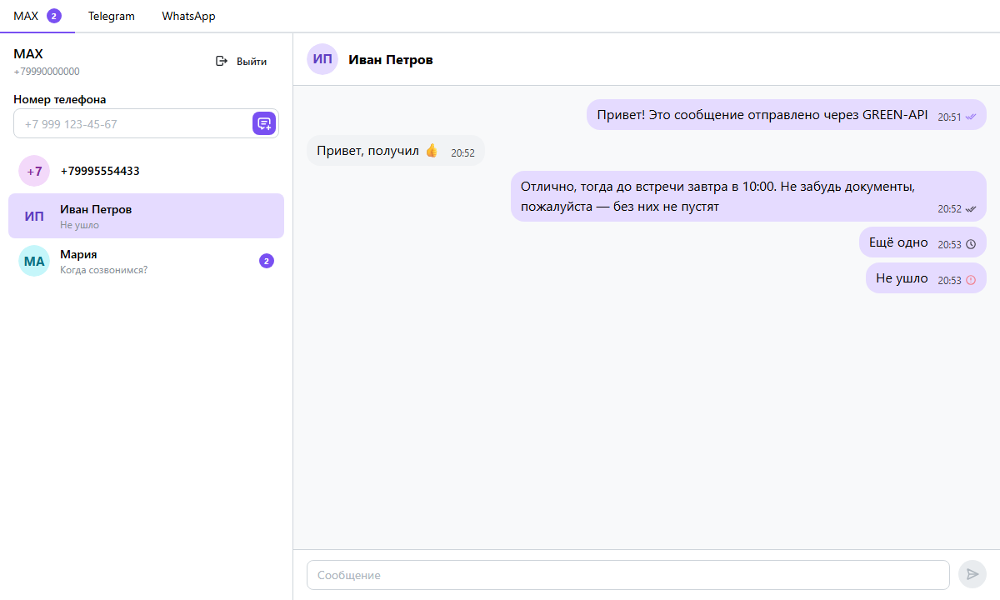
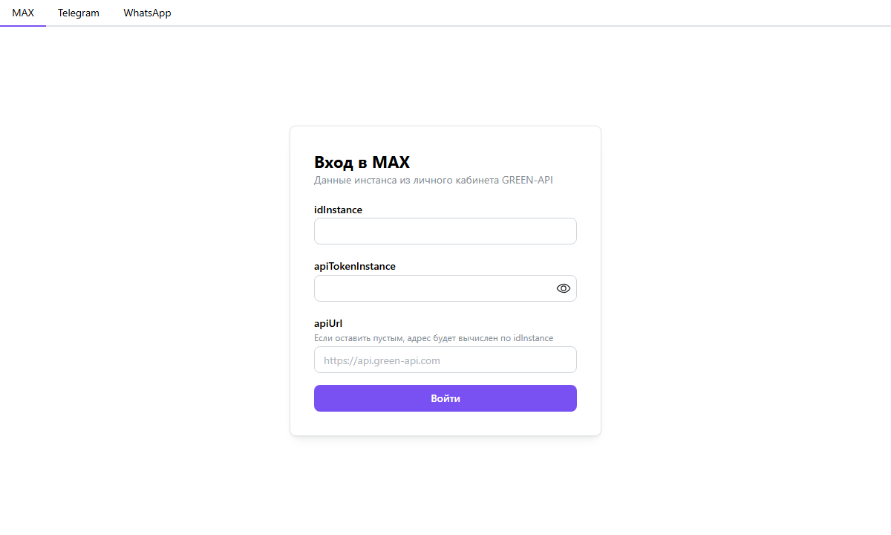
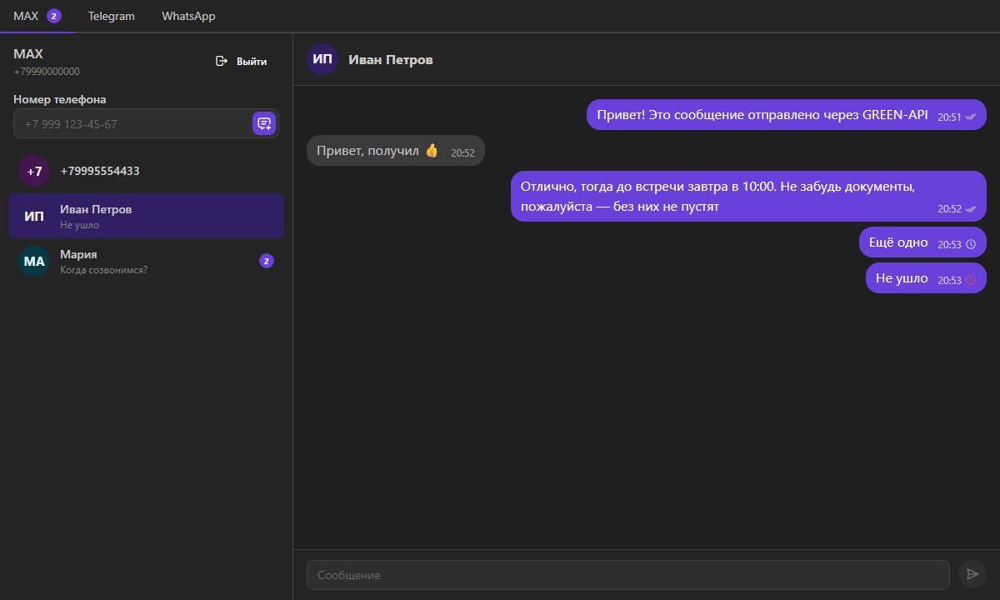
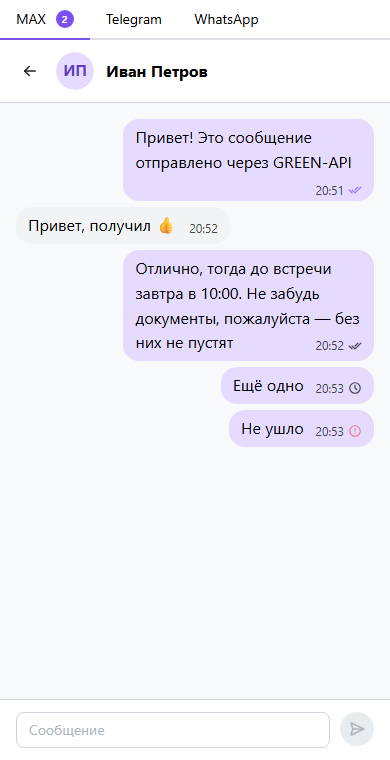

# Message Sender

Веб-чат для отправки и получения текстовых сообщений в **MAX**, **Telegram** и **WhatsApp** через
[GREEN-API](https://green-api.com). Выполнен как тестовое задание на должность фронтенд-разработчика React
([требования](REQUIREMENTS.md)), внешний вид повторяет [web.max.ru](https://web.max.ru/).

**Демо:** https://anrb13.github.io/message-sender/



## Возможности

- Вход по учётным данным инстанса GREEN-API (`idInstance`, `apiTokenInstance`). Приложение проверяет
  состояние инстанса и предлагает включить уведомления, если они выключены.
- Мессенджеры MAX, Telegram и WhatsApp в отдельных табах. У каждого таба своя сессия, на табе виден счётчик
  непрочитанных.
- Новый чат создаётся по номеру телефона. Приложение проверяет, что у номера есть аккаунт в мессенджере.
- Текстовые сообщения до 4000 символов. Отправка мгновенно отображается в чате, статусы:
  отправляется → ✓ отправлено → ✓✓ доставлено → ✓✓ прочитано, при ошибке — «Не доставлено».
- Входящие сообщения приходят через HTTP API GREEN-API (long polling, `receiveNotification`) — без
  перезагрузки страницы, в том числе в неактивные табы. Сообщения, отправленные с телефона, тоже
  появляются в чате.
- Светлая и тёмная тема по системной настройке, адаптивная вёрстка для телефона.
- Сессии и переписка сохраняются в `localStorage`.

| Вход | Тёмная тема | Телефон |
|---|---|---|
|  |  |  |

## Быстрый старт

Нужен Node.js 24+.

```bash
npm install
npx playwright install chromium   # браузер для тестов
npm run dev                       # http://localhost:5173
```

Как получить ключи инстанса и включить уведомления, описано в [docs/setup-green-api.md](docs/setup-green-api.md).

## Скрипты

| Команда | Что делает |
|---|---|
| `npm run dev` | dev-сервер с HMR |
| `npm run build` | проверка типов и production-сборка |
| `npm test` | тесты в watch-режиме (`npx vitest run` — однократно) |
| `npm run lint` | Oxlint |
| `npm run lint:fsd` | Steiger: проверка правил Feature-Sliced Design |
| `npm run typecheck` | проверка типов |

## Стек

- **React 19**, **TypeScript 6**, **Vite 8**
- **Zustand** — состояние: сессии, чаты, сообщения
- **Mantine 9** — базовые компоненты, стили подключаются точечно
- **БЭМ** — собственные стили
- **Feature-Sliced Design** — архитектура, проверяется Steiger
- **Vitest 4** в Browser Mode + Playwright — тесты в настоящем Chromium, разработка по TDD
- **Oxlint** — линтер
- **GitHub Actions** — lint → тесты → сборка → деплой на GitHub Pages

## Документация

- [Настройка GREEN-API](docs/setup-green-api.md): инстансы, ключи, уведомления, частые проблемы
- [Архитектура](docs/architecture.md): слои FSD, сторы, диаграммы входа, отправки и приёма сообщений
- [Интеграция с GREEN-API](docs/green-api-integration.md): методы, уведомления, адаптеры мессенджеров
- [Разработка](docs/development.md): скрипты, тесты, линтеры, стили, деплой, соглашения

## Структура

```
src/
  app/        точка входа, тема Mantine, глобальные стили
  pages/      messenger — табы мессенджеров
  widgets/    sidebar, chat-window
  features/   auth, create-chat, send-message, receive-messages
  entities/   messenger, session, chat
  shared/     api (клиент GREEN-API и адаптеры), lib, config
```
