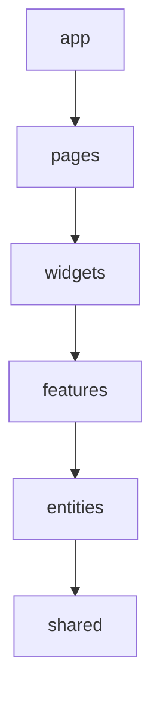
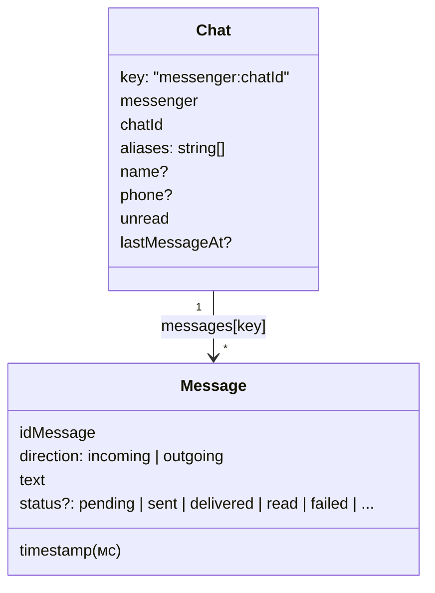
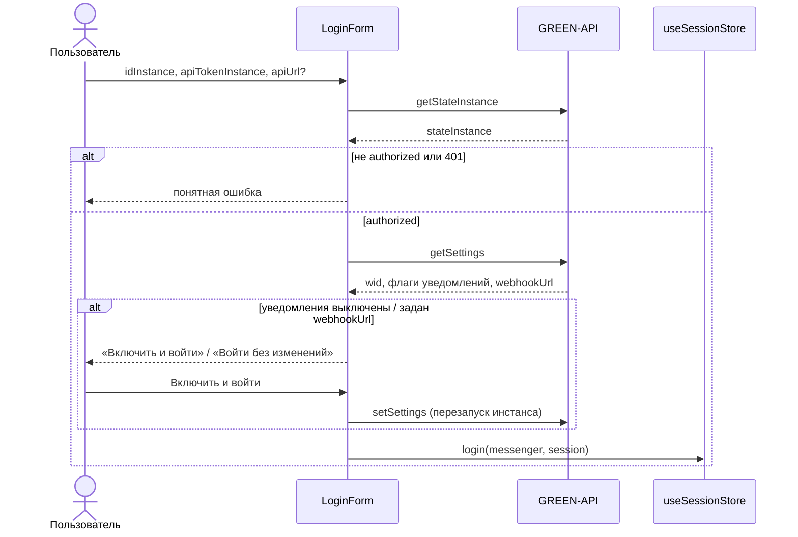
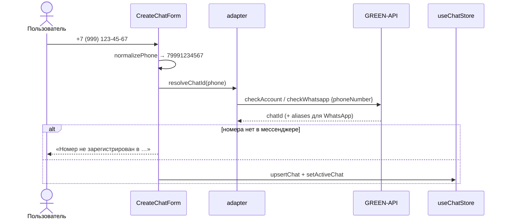
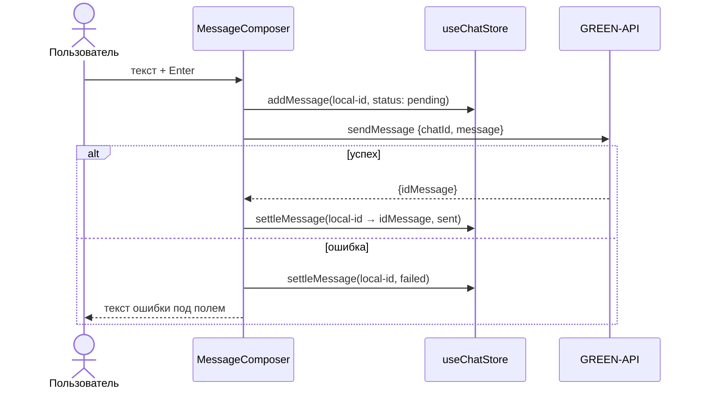
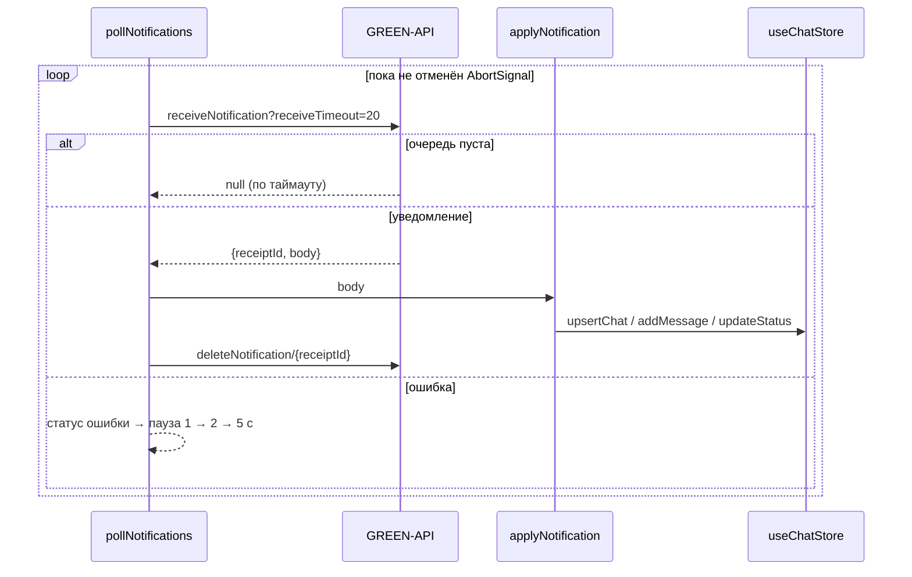

# Архитектура

Проект построен по [Feature-Sliced Design](https://feature-sliced.design/).

## Слои

| Слой | Что лежит | Слайсы |
|---|---|---|
| `app` | точка входа, тема Mantine, глобальные стили, ErrorBoundary | — |
| `pages` | экраны | `messenger` |
| `widgets` | крупные блоки экрана | `sidebar`, `chat-window` |
| `features` | пользовательские сценарии | `auth`, `create-chat`, `send-message`, `receive-messages` |
| `entities` | бизнес-сущности: данные и их отображение | `messenger`, `session`, `chat` |
| `shared` | переиспользуемый код без бизнес-логики | `api`, `lib`, `config` |

Правила:

- Модуль импортирует только из слоёв ниже себя. Слайсы одного слоя друг о друге не знают.
- Каждый слайс отдаёт наружу публичный API через `index.ts`. Импорт в обход него (`@/entities/chat/model/store`)
  запрещён.
- Внутри слайса код делится на сегменты по назначению: `model` (состояние), `ui` (компоненты), `lib` (хелперы),
  `api`.
- Правила проверяет Steiger: `npm run lint:fsd`.

## Сущности

### `entities/messenger`
Конфиг поддерживаемых мессенджеров (`MESSENGERS`, `MESSENGER_ORDER`): название и цвет таба.

### `entities/session`
`useSessionStore` (Zustand + persist, ключ `message-sender:session` в localStorage):

- `sessions`: учётные данные GREEN-API **для каждого мессенджера отдельно**, потому что у каждого свой инстанс;
- `activeMessenger`: выбранный таб;
- `login(messenger, session)`, `logout(messenger)`, `setActiveMessenger(messenger)`.

`apiTokenInstance` хранится в localStorage открытым текстом — без бэкенда он в любом случае нужен клиентскому
коду для прямых запросов к GREEN-API, шифрование на фронтенде не защитило бы от XSS. Поэтому критично не
добавлять в проект сторонние пакеты без аудита.

### `entities/chat`
`useChatStore` (Zustand + persist, ключ `message-sender:chats`):

- `upsertChat`: создаёт чат или дополняет существующий. Поиск идёт по `chatId` **и** `aliases`, потому что
  в WhatsApp один собеседник бывает и `@lid`, и `@c.us`. Пустые значения не затирают уже известные имя и телефон.
- `addMessage`: игнорирует дубли по `idMessage`. Сообщение, отправленное через API, приходит и в ответе
  `sendMessage`, и уведомлением. Список держится отсортированным по времени. Входящее сообщение в неактивный чат
  увеличивает `unread`.
- `updateStatus`: статусы не понижаются (`read` не меняется на `delivered`), а ошибки доставки перекрывают
  любой статус.
- `setActiveChat`: свой выбранный чат у каждого мессенджера, при выборе `unread` сбрасывается.
- `resetMessenger`: при выходе удаляются данные только этого мессенджера.
- `addMessage` хранит не больше `MAX_MESSAGES_PER_CHAT` (1000, [shared/config](../src/shared/config)) сообщений
  на чат, обрезая старые — вся переписка лежит в localStorage, и история не должна расти бесконечно.
- `recoverPendingMessages`: вызывается автоматически при восстановлении стора из localStorage (то есть на
  каждой загрузке страницы) и помечает `failed` сообщения, застрявшие в `pending`. Это сообщения, у которых
  промис `sendMessage` потерялся из-за перезагрузки страницы до ответа API — без этого статус «Отправляется…»
  остался бы навсегда.
- `version`/`migrate` в `persist` (у обоих сторов): форма данных может измениться, и тогда сохранённые чаты
  и сессии превращаются в новые, а не теряются при первом же несовпадении версии.
- `addMessage(chatKey, message, { visible })`: счётчик непрочитанных растёт только для чата, который
  пользователь действительно не видит. Признак видимости считает фича приёма: активный таб мессенджера,
  выбранный чат, не скрытая вкладка браузера.
- `storage` у стора чатов — обёртка над `localStorage`: при переполнении квоты история обрезается вдвое
  (удаляются самые старые сообщения), запись повторяется, а в сайдбаре появляется предупреждение
  (`useStorageNoticeStore`). Без этого `QuotaExceededError` вылетал из экшенов стора: отправка падала
  с технической ошибкой, а входящие терялись при перезагрузке страницы.

UI сущности: `ChatListItem` (строка списка чатов) и `MessageBubble` (пузырь сообщения со временем и статусом
✓ / ✓✓ / !).

## Фичи

### `features/auth`
`LoginForm` проверяет учётные данные и сохраняет сессию мессенджера. `LogoutButton` выходит из аккаунта
и удаляет переписку этого мессенджера.

- Пустой `apiUrl` заменяется адресом, вычисленным по `idInstance`.
- Ошибки GREEN-API переводятся в понятный текст функцией `describeError` ([shared/api](../src/shared/api)).

### `features/create-chat`
`CreateChatForm` принимает номер телефона, `createChat` строит по нему чат:

Ответ `checkAccount`/`checkWhatsapp` вида `{ status: false, reason }` (инстанс не авторизован, ещё
запускается, исчерпан лимит проверок) показывается как причина отказа, а не как «номера нет в мессенджере».
MAX принимает только номера РФ и Беларуси (+7, +375) — это проверяется до запроса к API.

### `features/send-message`
`MessageComposer`: Enter отправляет, Shift+Enter переносит строку, лимит 4000 символов. Отправка оптимистичная:

Если уведомление `outgoingAPIMessageReceived` с тем же `idMessage` придёт раньше ответа `sendMessage`,
`settleMessage` удалит временную копию, и дубля не будет.

### `features/receive-messages`
Приём сообщений через HTTP API GREEN-API (long polling). `useNotificationPolling` вызывается на странице
и запускает отдельный цикл `pollNotifications` для **каждого** подключённого мессенджера, поэтому сообщения
приходят и в неактивные табы. Вход или выход перезапускает цикл только своего мессенджера — остальные,
уже подключённые, продолжают приём без перерыва.

- `applyNotification` не хранит своего состояния: каждое уведомление она переводит в вызовы `useChatStore`:
  - `incomingMessageReceived` создаёт чат, если его ещё нет (имя и телефон берутся из `senderData`, в WhatsApp телефон — из chatId `номер@c.us`), и добавляет
    входящее сообщение;
  - `outgoingMessageReceived` (отправлено с телефона) и `outgoingAPIMessageReceived` добавляют исходящее.
    Дубли отсекаются по `idMessage`;
  - `outgoingMessageStatus` обновляет статус доставки;
  - нетекстовые сообщения и прочие уведомления игнорируются.
- Уведомление удаляется **всегда**, даже если обработчик упал. Иначе GREEN-API будет отдавать его снова,
  и очередь встанет. Повторная доставка безопасна благодаря дедупликации.
- Ошибки приёма попадают в `useConnectionStore`, и `ConnectionStatus` показывает их в сайдбаре. Например,
  если в инстансе задан `webhookUrl`, пользователь увидит подсказку очистить его. Цикл при этом
  переподключается сам.
- Уведомления забираются long polling: `receiveTimeout=20` держит запрос открытым, поэтому сообщение
  приходит без перезагрузки страницы. WebSocket в GREEN-API нет — подробнее в
  [green-api-integration.md](green-api-integration.md).
- При размонтировании циклы останавливаются, а записи о соединениях **удаляются** из `ref`. Это важно для
  dev-режима: StrictMode монтирует компонент дважды, и без удаления второй запуск эффекта решил бы, что
  приём уже идёт, и не запустил бы его заново — до перезагрузки страницы новые сообщения не приходили бы.
- Входящее считается прочитанным, только если чат реально виден: активен таб мессенджера, в нём выбран этот
  чат и вкладка браузера не скрыта (`isChatVisible`).
- Пустой текст и нетекстовые сообщения не создают ни сообщение, ни чат. Время из уведомления нормализуется
  (`toMilliseconds`): GREEN-API присылает секунды, но уже готовые миллисекунды не удвоятся.

## Виджеты

### `widgets/sidebar`
Шапка с названием мессенджера, своим номером (`formatWid(wid)`) и кнопкой выхода. Под ней форма создания
чата и список чатов: новые чаты без сообщений сверху, остальные по времени последнего сообщения. У каждого
чата видны последнее сообщение и счётчик непрочитанных.

### `widgets/chat-window`
Шапка с собеседником, переписка (`MessageBubble`) и поле ввода. Автопрокрутка вниз срабатывает при смене
чата и при новом сообщении, но только если пользователь уже у нижней границы: тому, кто читает историю
выше, новые сообщения прокрутку не выдёргивают. На узких экранах (< 48em) layout становится
одноколоночным: виден либо список чатов, либо открытый чат с кнопкой «Назад».

## Страницы

### `pages/messenger`
Табы MAX / Telegram / WhatsApp. На табе показывается число непрочитанных сообщений. Содержимое таба зависит
от сессии этого мессенджера: без неё показывается форма входа, с ней — чат. Неактивные табы не монтируются,
но сообщения в них продолжают приходить (см. `features/receive-messages`).
