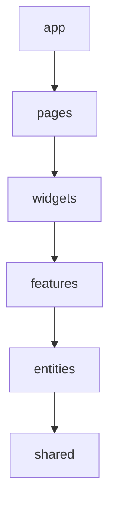
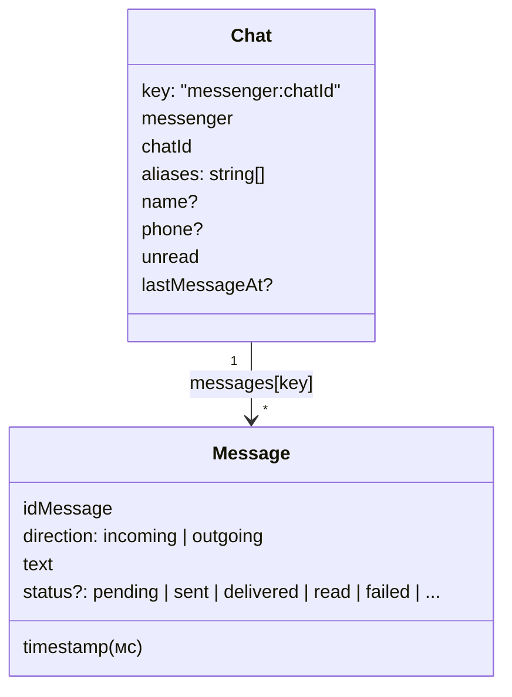
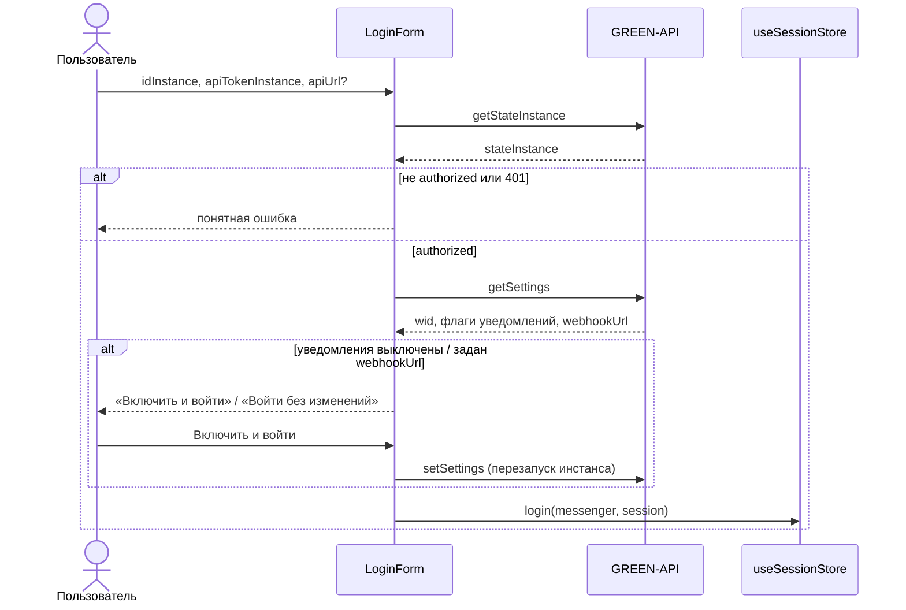
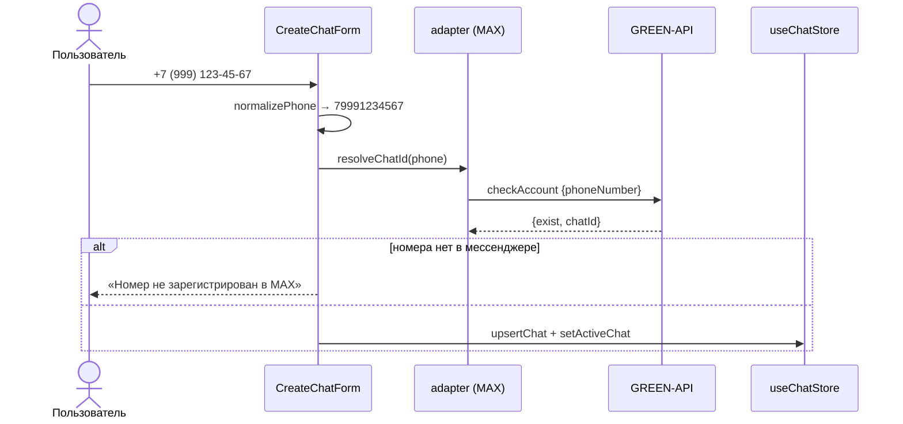
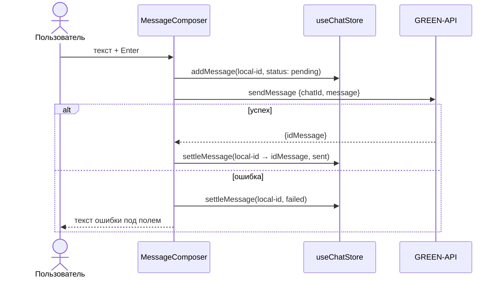

# Архитектура

Проект построен по [Feature-Sliced Design](https://feature-sliced.design/).

## Слои

| Слой | Что лежит | Слайсы |
|---|---|---|
| `app` | точка входа, тема Mantine, глобальные стили | — |
| `pages` | экраны | `messenger` |
| `widgets` | крупные блоки экрана | `sidebar`, `chat-window` |
| `features` | пользовательские сценарии | `auth`, `create-chat`, `send-message`, `receive-messages` |
| `entities` | бизнес-сущности: данные и их отображение | `messenger`, `session`, `chat` |
| `shared` | переиспользуемый код без бизнес-логики | `api`, `lib`, `config` |

Правила:

- Модуль импортирует только из слоёв ниже себя. Слайсы одного слоя друг о друге не знают.
- Каждый слайс отдаёт наружу публичный API через `index.ts`. Импорт в обход него (`@/entities/chat/model/store`)
  запрещён.
- Внутри слайса код делится на сегменты по назначению: `model` (состояние), `ui` (компоненты), `lib` (хелперы),
  `api`.
- Правила проверяет Steiger: `npm run lint:fsd`.

## Сущности

### `entities/messenger`
Конфиг поддерживаемых мессенджеров (`MESSENGERS`, `MESSENGER_ORDER`): название и цвет таба.

### `entities/session`
`useSessionStore` (Zustand + persist, ключ `message-sender:session` в localStorage):

- `sessions`: учётные данные GREEN-API **для каждого мессенджера отдельно**, потому что у каждого свой инстанс;
- `activeMessenger`: выбранный таб;
- `login(messenger, session)`, `logout(messenger)`, `setActiveMessenger(messenger)`.

### `entities/chat`
`useChatStore` (Zustand + persist, ключ `message-sender:chats`):

- `upsertChat`: создаёт чат или дополняет существующий. Поиск идёт по `chatId` **и** `aliases`, потому что
  в WhatsApp один собеседник бывает и `@lid`, и `@c.us`. Пустые значения не затирают уже известные имя и телефон.
- `addMessage`: игнорирует дубли по `idMessage`. Сообщение, отправленное через API, приходит и в ответе
  `sendMessage`, и уведомлением. Список держится отсортированным по времени. Входящее сообщение в неактивный чат
  увеличивает `unread`.
- `updateStatus`: статусы не понижаются (`read` не меняется на `delivered`), а ошибки доставки перекрывают
  любой статус.
- `setActiveChat`: свой выбранный чат у каждого мессенджера, при выборе `unread` сбрасывается.
- `resetMessenger`: при выходе удаляются данные только этого мессенджера.

UI сущности: `ChatListItem` (строка списка чатов) и `MessageBubble` (пузырь сообщения со временем и статусом
✓ / ✓✓ / !).

## Фичи

### `features/auth`
`LoginForm` проверяет учётные данные и сохраняет сессию мессенджера. `LogoutButton` выходит из аккаунта
и удаляет переписку этого мессенджера.

- Пустой `apiUrl` заменяется адресом, вычисленным по `idInstance`.
- Ошибки GREEN-API переводятся в понятный текст функцией `describeError` ([shared/api](../src/shared/api)).

## Страницы

### `pages/messenger`
Табы MAX / Telegram / WhatsApp. На табе показывается число непрочитанных сообщений. Содержимое таба зависит
от сессии этого мессенджера: без неё показывается форма входа, с ней — чат. Неактивные табы не монтируются.
Табы мессенджеров без адаптера пока отключены.

### `features/create-chat`
`CreateChatForm` принимает номер телефона, `createChat` строит по нему чат:

## Виджеты

### `widgets/sidebar`
Шапка с названием мессенджера, своим номером (`formatWid(wid)`) и кнопкой выхода. Под ней форма создания
чата и список чатов: новые чаты без сообщений сверху, остальные по времени последнего сообщения. У каждого
чата видны последнее сообщение и счётчик непрочитанных.

### `widgets/chat-window`
Шапка с собеседником, переписка (`MessageBubble`, автопрокрутка вниз) и поле ввода. На узких экранах
(< 48em) layout становится одноколоночным: виден либо список чатов, либо открытый чат с кнопкой «Назад».

### `features/send-message`
`MessageComposer`: Enter отправляет, Shift+Enter переносит строку, лимит 4000 символов. Отправка оптимистичная:

Если уведомление `outgoingAPIMessageReceived` с тем же `idMessage` придёт раньше ответа `sendMessage`,
`settleMessage` удалит временную копию, и дубля не будет.
